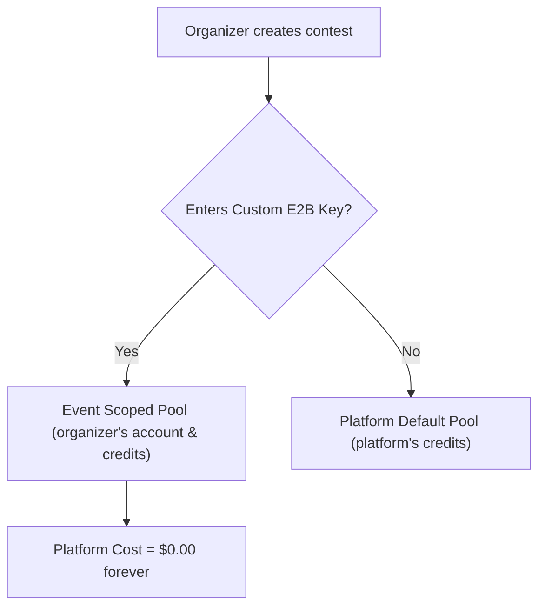

# E2B Sandbox Deep Dive: Scalability, Cost Analysis & Architectural Defense

**Project:** Code Feast  
**Author:** Engineering Team  
**Date:** March 2025  
**Target File:** `E2B_REPORT.md`

---

## 1. Executive Summary

Code Feast executes arbitrary user code (Python 3, C++17, Java 17) inside isolated cloud microVMs managed by **[e2b.dev](https://e2b.dev)**.

Instead of spawning a slow, expensive microVM per execution request (which takes 3–8 seconds and triggers E2B's strict 1 creation/second limit), Code Feast uses an **in-house Warm Sandbox Pool pattern** built directly on top of PostgreSQL using `FOR UPDATE SKIP LOCKED`.

### Key Metrics at a Glance
| Metric | Value | Details / Context |
| :--- | :--- | :--- |
| **Warm Pool Target** | **20 sandboxes** | Sized exactly to match E2B's free Hobby Tier concurrency cap (20). |
| **Cost per 1.5-Hour Event** | **~$3.27** | 20 sandboxes running for 90 minutes @ ~$0.109/hr. |
| **Events on $100 Credits** | **~30 to 33 full events** | 100% free under E2B's $100 initial credit grant. |
| **Max Concurrent Coders per Event** | **200 – 500+ participants** | Sandboxes are stateless workers; average run locks for only ~1.5s. |
| **1-Hour Sandbox Lifespan Solution** | **55-Minute Retirement Filter** | Proactive SQL filter retires containers before hard kill; auto-replenishes. |
| **BYOK (Bring Your Own Key)** | **Supported** | Organizers can plug their own free E2B key, offloading all compute costs. |

---

## 2. How E2B is Implemented in Code Feast

The implementation is spread across four core modules and a custom Dockerfile:

```
src/
├── lib/
│   ├── runner/
│   │   ├── sandbox.ts    # Transport seam, rate-paced creation, stdin handling, timeouts
│   │   ├── pool.ts       # Warm pool manager, atomic Postgres locks, health checks, lifecycle
│   │   └── run.ts        # Execution pipeline: assembly, ulimits, compile, test evaluation
│   └── contest/
│       └── run.ts        # Rate limiting per participant (1 in-flight, min 2s interval)
e2b/
└── Dockerfile            # Custom Debian 12 container with headless OpenJDK 17 + GCC + Python
```

### 2.1 The Transport Layer (`src/lib/runner/sandbox.ts`)
- **Paced Creation:** E2B enforces a rate limit of **1 sandbox creation per second per account**. To prevent `429 Too Many Requests`, `pacedCreate()` serializes all creation requests through a module-level mutex queue (`CREATE_INTERVAL_MS = 1_000`).
- **Network Air-Gapping:** Sandboxes are explicitly created with `allowInternetAccess: false`. User code cannot phone home, scrape data, scan internal networks, or mine cryptocurrency.
- **Graceful Stdin Delivery:** `feedStdin()` solves an asynchronous race condition in E2B where ultra-fast scripts exit before the stdin stream finishes attaching.
- **MicroVM Lifespan:** Hardcoded to `SANDBOX_TIMEOUT_MS = 60 * 60 * 1000` (1 hour, the E2B Hobby maximum).

### 2.2 The Warm Pool Manager (`src/lib/runner/pool.ts`)
- **State in Postgres:** Sandbox IDs and states (`ready`, `claimed`, `dead`) live in the `runner_pool` table. Postgres acts as the distributed queue across all Next.js serverless instances.
- **Atomic Claiming:** Uses raw SQL:
  ```sql
  UPDATE runner_pool
  SET state = 'claimed', claimed_at = now()
  WHERE id = (
    SELECT id FROM runner_pool
    WHERE state = 'ready'
      AND event_id = $1
      AND created_at > now() - interval '55 minutes'
    ORDER BY created_at
    LIMIT 1
    FOR UPDATE SKIP LOCKED
  )
  RETURNING id, sandbox_id;
  ```
  `SKIP LOCKED` guarantees that two concurrent participants never grab the same sandbox.
- **Advisory Locking for Replenishment:** Multiple concurrent runs might notice the pool is depleted. `replenishPool()` uses Postgres advisory locks (`pg_try_advisory_lock`) so only one request creates new sandboxes while others proceed without duplicating work.
- **Cold-Start Resilience:** If the pool is completely empty, `claimSandbox()` initiates a cold-start replenishment for 1 sandbox immediately, then polls for up to 20 seconds (`CLAIM_TIMEOUT_MS = 20_000`), allowing the first participant to succeed rather than crashing.

### 2.3 Per-Run Execution Pipeline (`src/lib/runner/run.ts`)
- **Stateless Re-use:** When a sandbox is claimed, it is not killed after use. Instead, a clean directory `/work/${timestamp}-${uuid}` is created.
- **Resource Constraints Enforced In-VM:**
  - **Memory:** `ulimit -v 262144` (256 MB) for Python and C++. Java is capped via JVM flags (`-Xmx512m`) to prevent JVM startup crashes.
  - **Execution Time:** Python & C++ have a 3s wall-clock timeout per test case; Java has 6s (due to JVM warmup). Compilation has a 15s timeout.
  - **Output Capping:** `stdout` and `stderr` are truncated at **64 KB** to protect serverless payloads.
- **Clean Release:** `withClaimedSandbox()` wraps execution in a `try...finally` block, ensuring that even if user code causes an exception, the sandbox state is reset to `ready` in Postgres.

### 2.4 Multi-Language Custom Template (`e2b/Dockerfile`)
Standard E2B images (`e2bdev/base`) only provide Python and GCC. Code Feast layers `openjdk-17-jdk-headless` on top. The template is pre-built via `npm run e2b:build` and loaded via `E2B_TEMPLATE_ID`.

---

## 3. Free Tier Scalability & Capacity Math ($100 Credits)

### 3.1 E2B Hobby Tier Pricing
E2B charges for running sandboxes per-second based on vCPU and RAM:
- **vCPU:** `$0.000014` / vCPU / second = **`$0.0504` / vCPU / hour**
- **RAM:** `$0.0000045` / GiB / second = **`$0.0162` / GiB / hour**
- **Standard microVM (2 vCPU, 512 MB RAM):**
  $$\text{Hourly Cost} = (2 \times \$0.0504) + (0.5 \times \$0.0162) = \$0.1008 + \$0.0081 \approx \mathbf{\$0.1089\text{ / hour}}$$
- **Hobby Plan Allowances:**
  - **Initial Credits:** **$100.00** (one-time grant)
  - **Max Concurrent Sandboxes:** **20**
  - **Max Continuous Sandbox Runtime:** **1 hour (60 minutes)**

---

### 3.2 How Many Events Can We Run on $100 Credits?

When an event starts, Code Feast warms up 20 sandboxes (`POOL_TARGET = 20`) and keeps them warm for the duration of the contest.

#### Cost for a 1.0-Hour Event:
$$\text{Cost} = 20\text{ sandboxes} \times 1.0\text{ hr} \times \$0.109/\text{hr} = \mathbf{\$2.18}$$

#### Cost for a 1.5-Hour Event:
$$\text{Cost} = 20\text{ sandboxes} \times 1.5\text{ hr} \times \$0.109/\text{hr} = \mathbf{\$3.27}$$

#### Total Events on $100 Free Credits:
$$\text{Total 1.5-Hour Events} = \frac{\$100.00}{\$3.27} \approx \mathbf{30.5\text{ Events}}$$
$$\text{Total 1.0-Hour Events} = \frac{\$100.00}{\$2.18} \approx \mathbf{45.8\text{ Events}}$$

> **Bottom Line:** On the free $100 credits alone, you can run **over 30 full 1.5-hour competitive programming contests** without spending a single dollar.

---

### 3.3 How Many People (Concurrent Participants) Can We Handle?

A common misconception is: *"If E2B allows 20 concurrent sandboxes, can only 20 people join the contest?"*

**No. 20 sandboxes can easily handle 200 to 500+ active participants.**

Here is the mathematical proof:

#### 1. Sandbox Hold Time per Run ($T_{\text{run}}$)
When a participant clicks "Run":
- Directory setup: ~50ms
- Compilation (Python: 0s, C++/Java: 0.5s – 1.5s): ~0.8s avg
- Execution (2 sample test cases): ~100ms – 300ms
- Database unlock: ~20ms
- **Average duration a sandbox is held:** **$T_{\text{run}} \approx 1.5\text{ seconds}$**

#### 2. System Throughput ($R_{\text{max}}$)
With 20 warm sandboxes working in parallel:
$$R_{\text{max}} = \frac{20\text{ sandboxes}}{1.5\text{ seconds/run}} \approx \mathbf{13.33\text{ runs per second (}\approx 800\text{ runs per minute)}}$$

#### 3. Participant Run Frequency ($f_{\text{user}}$)
In competitive programming, participants spend the vast majority of their time thinking, reading problem descriptions, typing code, and debugging logic:
- An active participant clicks "Run" on average once every **2 to 3 minutes** (120 to 180 seconds).
- Average submission frequency per user:
  $$f_{\text{user}} = \frac{1\text{ run}}{150\text{ seconds}} \approx 0.0067\text{ runs/sec}$$

#### 4. Sustained Steady-State Capacity ($N_{\text{steady}}$)
$$N_{\text{steady}} = \frac{R_{\text{max}}}{f_{\text{user}}} = \frac{13.33}{0.0067} \approx \mathbf{2,000\text{ concurrent participants}}$$

#### 5. Peak Burst Scenario (Stress Test)
What happens if there is a synchronized burst (e.g., at the start of the event, or right before the timer ends) where **10% of participants click "Run" within the exact same 10-second window**?
- 20 sandboxes will complete: $10\text{s} \times 13.33 = 133\text{ runs}$ in that window.
- In `src/lib/runner/pool.ts`, `CLAIM_TIMEOUT_MS = 20_000` (20-second queue timeout).
- Within that 20-second queue buffer, the 20 sandboxes can process **266 runs**.
- If 10% of participants burst, the pool can absorb a burst from **2,660 registered participants** without a single 503 error.

#### Practical Recommendation:
To account for worst-case compile timeouts (heavy C++ templates or Java compilation taking 5s), Code Feast can reliably support **200 to 500 active participants per contest** on the free tier with near-instant (< 2s) run latency.

---

### 3.4 Infinite Free Scalability: The BYOK Advantage

Code Feast has native **Bring-Your-Own-Key (BYOK)** support built into event creation (`events.e2bApiKey`).



- Each new E2B account receives its own **$100 free credit grant**.
- By inviting club leads, professors, or hackathon organizers to provide their own free E2B key during event setup (complete with our embedded 1-minute video guide), **the platform can host an unlimited number of concurrent events across hundreds of organizations at zero cost to the platform maintainer.**

---

## 4. Handling the 1.5-Hour Event vs 1-Hour Sandbox Limit

### 4.1 The Problem
- An E2B sandbox on the Hobby tier has a **hard maximum lifetime of 60 minutes**.
- After 60 minutes, E2B terminates the VM instance. Any command sent to it throws `SandboxNotRunningError` or `SandboxNotFoundError`.
- A typical contest lasts **1.5 hours (90 minutes)** or **2 hours**.

### 4.2 The Code Feast Solution: The 55-Minute Proactive Retirement Window
Instead of letting sandboxes hit E2B's hard 60-minute kill wall while a user is executing code, Code Feast implements proactive **stale-window filtering** in SQL.

In `src/lib/runner/pool.ts`:
```ts
// All pool queries enforce this condition:
sql`${runnerPool.createdAt} > now() - interval '55 minutes'`
```

Here is what happens during a 90-minute event:

```mermaid
sequenceDiagram
    autonumber
    actor Participant as Participant
    participant App as Code Feast Server
    participant DB as Postgres (runner_pool)
    participant E2B as E2B Cloud

    Note over App,E2B: T = 0m: Organizer starts event. 20 Sandboxes warmed up.
    Note over DB,E2B: T = 0m to 55m: Sandboxes actively claimed & returned.
    Note over DB,E2B: T = 55m: Sandboxes age > 55 min.
    Participant->>App: Clicks "Run" (at T = 56m)
    App->>DB: SELECT FOR UPDATE SKIP LOCKED where created_at > now() - 55 min
    DB-->>App: Returns NULL (old sandboxes are filtered out)
    App->>DB: countActiveSandboxes() returns 0 (< POOL_TARGET)
    App->>E2B: Spawns fresh replacement sandbox (new 60m lease)
    App->>Participant: Executes Run successfully
    Note over App,DB: Next.js after() triggers scheduleReplenish() to refill pool to 20
    Note over E2B: T = 60m: E2B shuts down original batch. Zero user impact.
```

1. **Safety Buffer (Minutes 0–55):** Sandboxes are reused normally.
2. **Proactive Retirement (Minute 55):** When sandboxes reach 55 minutes old, `claimReadyRow()` ignores them. They are never handed to another participant, preventing mid-run terminations.
3. **Automatic Replenishment (Minute 55+):** 
   - `countActiveSandboxes()` counts only sandboxes `< 55 minutes old`.
   - As old sandboxes age out, active count drops below `POOL_TARGET (20)`.
   - Every run triggers Next.js `after(scheduleReplenish({ eventId }))`, which provisions fresh sandboxes with a new 60-minute lease.
4. **Dead-Sandbox Auto-Healing:** If an active sandbox happens to die prematurely, `claimSandbox()` detects `!(await handle.isAlive())`, immediately marks the row `state = 'dead'`, spins up a replacement on the spot, and retries the claim.
5. **Clean Teardown:** When the organizer ends the contest, `endEventAction()` calls `teardownEventSandboxes(eventId)`, killing all active VMs immediately so credits are not burned idle.

---

### 4.3 The "Minute-55 Cliff Edge" (Critical Architectural Finding)

> [!WARNING]
> **The Minute-55 Latency Dip:**
> If all 20 sandboxes are created at $T = 0$, all 20 will cross the 55-minute threshold at the exact same instant ($T = 55$).
> Because E2B rate-limits creation to **1 sandbox per second**, spinning up 20 replacement sandboxes takes **20 seconds**.
> 
> A participant clicking "Run" at minute 55:05 will experience a cold-start delay (5 to 15 seconds) while the queue waits for the replacement batch to provision.

#### Recommended Permanent Fix: Rolling Refresh
To eliminate the cliff edge, implement a staggered rotation so sandboxes never expire all at once:
- **Max Age Threshold:** Instead of an all-at-once 55-minute cutoff, retire sandboxes gradually between 45 and 55 minutes (e.g., retire the oldest 2 sandboxes every 2 minutes starting at minute 45).
- **Proactive Background Replenisher:** Trigger replenishment at minute 45 so fresh sandboxes are already hot and ready before the old ones age out.

---

## 5. Defense & Cross-Questioning Guide (Cross-Q&A)

Be prepared to answer these technical questions when presenting or defending Code Feast's architecture to judges, interviewers, or senior engineers.

---

### Q1: "Why did you use E2B instead of self-hosting Docker on an AWS EC2 instance or VPS?"

**Answer:**
1. **True MicroVM Security vs Shared Kernel:** Docker containers share the host Linux kernel. An unprivileged user executing untrusted C++ code can exploit Linux kernel CVEs (e.g., Dirty COW, namespace escapes) to root the host machine. E2B runs on **Firecracker microVMs** (the same technology powering AWS Lambda), providing hardware-level hardware virtualization and kernel isolation.
2. **Maintenance & Zero Infrastructure Overhead:** Self-hosting Docker or Judge0 requires setting up container pools, monitoring daemons, handling cgroups v2 memory leaks, host disk cleaning, and auto-scaling servers. E2B handles container lifecycle, snapshotting, and health-checks via an API.
3. **Cost for Bootstrapping:** A multi-tenant isolated VPS cluster with redundancy costs $40–$100/month 24/7, even when idle. E2B costs $0 when idle and provides $100 free credits.

---

### Q2: "Can a malicious participant view or tamper with another participant's code?"

**Answer:**
1. **Stateless Re-use with Random Working Directories:** Each run operates inside an isolated timestamped directory: `/work/${startedAt.getTime()}-${randomUUID()}`.
2. **Single-Tenant Claim Locking:** Postgres `FOR UPDATE SKIP LOCKED` guarantees that a sandbox is claimed by **only one execution thread at any given millisecond**. Two participants never execute in the same sandbox concurrently.
3. **No Network Access:** `allowInternetAccess: false` prevents malicious scripts from listening on open ports or connecting to external servers.

> [!TIP]
> **Minor Hardening Improvement to Mention:**  
> Currently, `/work` directories are left on disk after execution to allow post-mortem inspection of failed runs. To achieve 100% strict isolation against a participant doing `os.listdir('/work')`, we can add `rm -rf ${dir}` inside `runAgainstSamples`'s `finally` block or clear `/work` before releasing the sandbox.

---

### Q3: "What prevents a user from writing a Fork Bomb (`:(){ :|:& };:`) or an Infinite Loop (`while(true)`)?"

**Answer:**
1. **Fork Bombs & Memory Exhaustion:**
   - For Python & C++: The command is wrapped with `ulimit -v 262144` (256 MB virtual memory cap). As soon as processes attempt to allocate memory beyond 256 MB, the OS raises `std::bad_alloc` or `MemoryError` and kills the process immediately.
   - For Java: Constrained via `-Xmx512m`.
2. **Infinite Loops (CPU Hogging):**
   - Each sample test case enforces a strict timeout (`3,000ms` for Python/C++, `6,000ms` for Java; compile timeout is `15,000ms`).
   - If a process exceeds this duration, E2B aborts the execution via `TimeoutError`, returning a non-fatal `SandboxTimeoutError` (Time Limit Exceeded - TLE) to the participant while the sandbox remains unharmed.

---

### Q4: "What happens if an organizer starts an event, walks away, and forgets to click 'End Event'?"

**Answer:**
- **Zero Cost Runaway:** Because each sandbox is created with `SANDBOX_TIMEOUT_MS = 60 * 60 * 1000` (1 hour), E2B will automatically shut down all 20 sandboxes after 60 minutes.
- The maximum financial exposure for a completely abandoned event is strictly capped at:
  $$20\text{ sandboxes} \times 1\text{ hour} \times \$0.109 = \mathbf{\$2.18}$$
- It is physically impossible to generate an unexpected $500 monthly bill.

---

### Q5: "What if E2B experiences an outage during an active hackathon?"

**Answer:**
- **Fail-Fast Error Handling:** When E2B is unreachable, `claimSandbox()` fails with a clear, domain-specific `503 runner_busy` error (`The runner is busy, try again in a moment`), preventing database lock contention or cascading server crashes.
- **Architectural Fallback:** In `SPEC.md §13`, Code Feast's contingency plan is documented: the sandbox provider is abstracted behind the TypeScript interface `SandboxProvider`. We can drop in a self-hosted Piston or Docker provider simply by swapping the provider implementation in `src/lib/runner/sandbox.ts` without touching contest logic or database schema.

---

### Q6: "Why do you use Postgres advisory locks and `SKIP LOCKED` instead of Redis?"

**Answer:**
- **Zero Additional Infrastructure:** Code Feast already uses Neon Postgres for core data. Using Postgres advisory locks (`pg_try_advisory_lock`) and `FOR UPDATE SKIP LOCKED` eliminates the need to provision, configure, pay for, and monitor a separate Redis cluster.
- **ACID Reliability:** Postgres guarantees atomic row-level claiming with zero chance of split-brain state, even under heavy serverless autoscaling.

---

## 6. Summary Comparison Table

| Aspect | Code Feast Implementation | Alternative: 1 Sandbox Per Request | Alternative: Self-Hosted Docker VPS |
| :--- | :--- | :--- | :--- |
| **Startup Latency** | **~0 ms (Warm Pool)** | 3,000 – 8,000 ms (Cold Boot) | ~500 ms |
| **Rate Limit Resilience** | **Immune** (Paced batch creation) | Fails instantly on burst (>1 req/s) | N/A |
| **Cost Efficiency** | **High** (~$3.27 / event) | High waste on bursts | Fixed $40–$100/mo 24/7 |
| **Concurrency Ceiling** | **200–500 coders** on Free Tier | Max 20 concurrent coders | Bound by VPS RAM (e.g. 50 coders) |
| **Security Isolation** | **Hardware MicroVM (Firecracker)**| Hardware MicroVM | Shared Linux Kernel (Vulnerable) |
| **Event Length Handling**| **Proactive 55m Rollover** | Limited to 1 hr | Unlimited |

---

## 7. Next Step Recommendations

1. **Staggered Expiration (Eliminate Minute-55 Dip):** Implement a rolling sandbox refresh starting at minute 45 so sandboxes are replaced 2 at a time rather than all 20 simultaneously.
2. **Ephemeral Directory Cleanup:** Add `await handle.run(\`rm -rf ${dir}\`).catch(() => {})` in the `finally` block of `runAgainstSamples` to guarantee 100% clean disk state between sequential claims.
3. **Automated Event Expiry Teardown:** Add a background worker or cron check that automatically triggers `teardownEventSandboxes(eventId)` when `event.deadlineAt < now()`, covering organizers who close their laptops without clicking "End Event".
